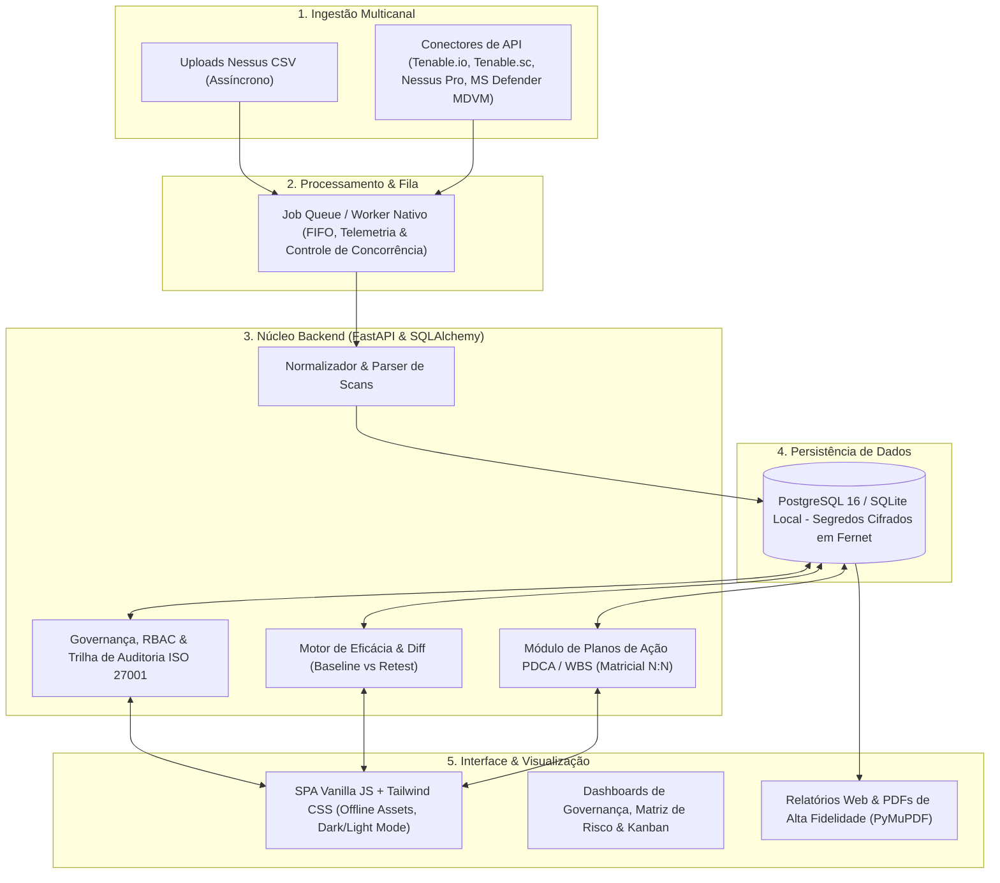
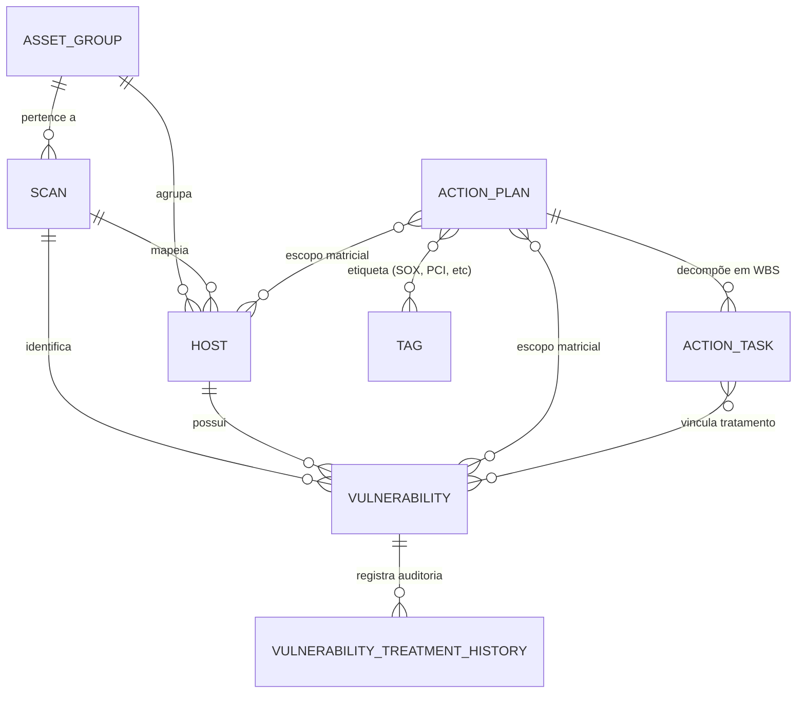

# GvulStand — Apresentação Gerencial e Estrutural da Plataforma

---

## 1. Sumário Executivo

O **GvulStand** é uma plataforma corporativa web voltada à **orquestração, governança e gestão do ciclo de vida de vulnerabilidades de segurança da informação**.

Diferente de visualizadores passivos de relatórios ou de sistemas genéricos de tickets, o GvulStand estrutura todo o processo operacional sob os pilares da **ISO/IEC 27001 (Controle 8.8 — Gestão de Vulnerabilidades Técnicas)** e do ciclo **PDCA da ISO 9001**. O produto transforma dados brutos e dispersos de varreduras em projetos de remediação estruturados com comprovação matemática de eficácia antes (*baseline*) e depois (*retest*).

---

## 2. Arquitetura Técnica e Fundações do Sistema

O projeto adota uma arquitetura desacoplada, segura e desenhada para operação em redes corporativas com suporte nativo a ambientes isolados (*air-gapped*):



### Componentes de Tecnologia:
- **Backend:** FastAPI (Python 3.12) assíncrono, SQLAlchemy 2.0 e validação de contratos com Pydantic v2.
- **Banco de Dados:** PostgreSQL 16 (produção/Docker) e SQLite (desenvolvimento/testes locais), com credenciais de scanners e senhas de integração protegidas por criptografia **Fernet**.
- **Processamento Assíncrono:** Fila de trabalhos nativa (`ImportJob`) com telemetria de progresso em tempo real e controle de concorrência para upload de grandes volumes de dados.
- **Frontend:** SPA leve em HTML5, Vanilla JavaScript e Tailwind CSS standalone. Não há dependências externas ou chamadas a CDNs públicos (100% dos assets e fontes são locais/air-gapped).
- **Segurança e Identidade:** Autenticação JWT, integração corporativa com **LDAP / Active Directory (StartTLS/SSL)** e controle de acesso granular baseado em papéis (**RBAC**: *Admin*, *Analyst*, *Auditor*) com delegação de escopo por Grupos de Ativos.

---

## 3. Armazenamento e Cruzamento de Informações

A modelagem de dados do GvulStand centraliza a gestão de segurança através de entidades altamente correlacionadas:



### 3.1. Como os Dados São Cruzados e Correlacionados?

1. **Assinatura Determinística por Vetor de Risco:**  
   O motor comparativo de eficácia avalia a integridade do ambiente confrontando varreduras através da chave única:
   $$\text{Assinatura} = (\text{Host IP}, \text{Plugin ID}, \text{Porta}, \text{Protocolo})$$
   Isso permite que um scan de Reteste seja confrontado item a item contra a Linha de Base (*Baseline*), categorizando com exatidão:
   - **Remediada (*Remediated*):** Presente no baseline e extinta no reteste (sucesso comprovado).
   - **Persistente (*Persisting*):** Permanece aberta mesmo após as ações de correção.
   - **Novo Achado / Regressão (*New Findings*):** Nova brecha detectada durante a rechecagem.

2. **Matriz de Ameaça Iminente (CVSS + VPR + Exploits + Malware):**  
   O sistema combina a severidade teórica do CVSS v2/v3 e pontuação VPR com indicadores reais de ameaça: **disponibilidade de exploit público**, inclusão em frameworks de exploração (*Metasploit, Core Impact, Canvas*) e infecção por **malware ativo**, permitindo priorização cirúrgica.

3. **Ciclo de Vida do Ativo e Detecção de SO Obsoleto (*End-of-Life / EOL*):**  
   Os hosts inventariados são cruzados com uma base de ciclo de vida de sistemas operacionais, sinalizando ativos que já atingiram ou estão próximos do Fim de Vida Útil (ex.: Windows Server 2008/2012, CentOS 7, Debian legados) e que não recebem mais patches de segurança.

4. **Trilha de Auditoria Obrigatória e Imutável (ISO 27001):**  
   Toda modificação de status de vulnerabilidade (*Open*, *In_Remediation*, *Accepted_Risk*, *Remediated*) exige justificativa formal e registra de forma indelével: **responsável pela ação**, **data e hora (UTC com conversão ao fuso parametrizado)**, **estado anterior/novo** e a **nota técnica de auditoria**.

---

## 4. Principais Módulos e Funcionalidades

| Módulo | Finalidade e Recursos Operacionais |
|---|---|
| **Painel Executivo (Dashboard)** | Visão centralizada em tempo real com *Posture Score* (0 a 100), Índice de Risco ISO 27001, Eficiência de Remediação ISO 9001, Aging de vulnerabilidades (0-30, 31-60, 61-90, >90 dias), Matriz de Cumprimento de SLAs e quebra de ameaças. |
| **Top 100 Críticas & Top 20 Hosts** | Foco de remediação imediata: isolamento das 100 vulnerabilidades de maior impacto e dos 20 servidores que concentram os maiores volumes de exploits acionáveis. |
| **Inventário Unificado de Ativos** | Catálogo consolidado de hosts com cálculo automático de *Risk Score* individual por ativo, histórico de varreduras e alerta de sistemas operacionais em EOL. |
| **Planos de Ação (WBS / PDCA)** | Gestão estruturada de projetos de remediação em visualizações de **Lista e Kanban**. Suporta escopos por Host, Vulnerabilidade, Grupo de Ativos ou Matricial N:N. Possui funcionalidade de **Simulação de Impacto Prévia (*Preview Impact*)**, estimando o ganho de postura antes de iniciar as intervenções. |
| **Motor de Eficácia & Diff** | Comparador algorítmico entre varredura inicial (*Baseline*) e pós-correção (*Reteste*), emitindo percentual de eficácia e lista de pendências persistentes. |
| **Diagnóstico de Scans & Troubleshoot** | Detector inteligente de falhas de varredura (falhas de login Windows SMB/WMI, SSH, comandos sem privilégio sudo ou bloqueios de firewall/ICMP), prevenindo falsos-negativos por escaneamentos incompletos. |
| **Central de Relatórios (Web & PDF)** | Emissão de relatórios executivos, relatórios técnicos analíticos e relatórios formais de auditoria de SLA, disponíveis em visualização interativa e documentos **PDF de alta fidelidade visual** gerados via PyMuPDF. |
| **Integrações de Scanners & Fila Assíncrona** | Upload manual de arquivos Nessus CSV e sincronização agendada via API para Tenable.io, Tenable.sc, Nessus Professional e Microsoft Defender for Endpoint (MDVM). |
| **Parametrizações Globais** | Configuração de fuso horário operacional, prazos globais de SLA por severidade (padrão: 7/15/30/60 dias ou customizado por Grupo) e listas de exclusão formal de falsos-positivos. |

---

## 5. Ganhos e Benefícios Estratégicos

### 1. Centralização e Eliminação de Silos
- **Visão Unificada da Superfície de Ataque:** Consolidação de scanners de infraestrutura de rede e ferramentas de proteção de endpoint em um único repositório auditável.
- **Substituição de Planilhas Dispersas:** Elimina controles manuais e planilhas desatualizadas em favor de uma base transacional multiusuário com controle de concorrência.

### 2. Priorização Cirúrgica Baseada em Risco Real
- **Redução da Fadiga de Alertas:** Direciona a capacidade produtiva da equipe técnica para as vulnerabilidades com exploits funcionais e perigo iminente de invasão.
- **Previsibilidade Operacional:** A simulação de impacto permite demonstrar previamente à gestão o percentual de redução de risco antes do início de uma janela de manutenção.

### 3. Governança, Compliance e Prontidão de Auditoria (ISO 27001 / ISO 9001)
- **Rastreabilidade Inegociável:** Qualquer aceitação de risco ou adiamento é obrigatoriamente justificado e registrado no histórico, eliminando pontos cegos em auditorias externas.
- **Comprovação de SLA:** Métricas claras e históricas sobre o cumprimento dos prazos estabelecidos nas políticas de segurança corporativas.

### 4. Integração Operacional entre SecOps e Infraestrutura/TI
- **Projetos WBS Estruturados:** A equipe de segurança não apenas "aponta problemas", mas entrega planos de trabalho com tarefas claras, prazos e donos definidos.
- **Ciclo Fechado de Remediação:** A confirmação de que um patch corrigiu efetivamente o problema deixa de ser teórica e passa a ser matematicamente atestada no Reteste.

### 5. Comunicação Transversal (Do Analista à Diretoria)
- Os especialistas de infraestrutura recebem dados técnicos detalhados (portas, protocolos, soluções e CVEs), enquanto os gestores e o CISO acompanham índices executivos consolidados e relatórios formais em PDF.

---

### Resumo das Frentes de Impacto

```
                  ┌──────────────────────────────────────────────┐
                  │          PLATAFORMA GVULSTAND                │
                  └──────────────────────┬───────────────────────┘
                                         │
         ┌───────────────────────────────┼───────────────────────────────┐
         ▼                               ▼                               ▼
  [ NÍVEL OPERACIONAL ]          [ NÍVEL TÁTICO ]              [ NÍVEL ESTRATÉGICO ]
  • Diagnóstico de varredura     • Planos de Ação (WBS/Kanban) • Posture Score em tempo real
  • Soluções técnicas de patch   • SLA por grupo de ativos     • Relatórios Executivos em PDF
  • Filtro de exploits ativos    • Eficácia de Reteste (Diff)  • Conformidade ISO 27001 / 9001
```
